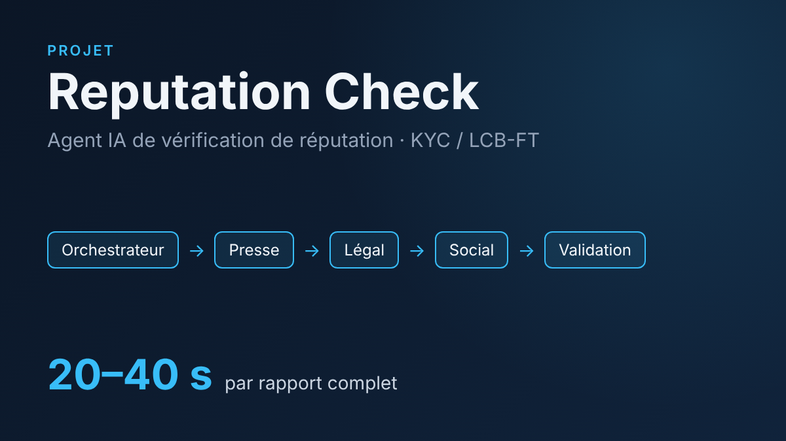
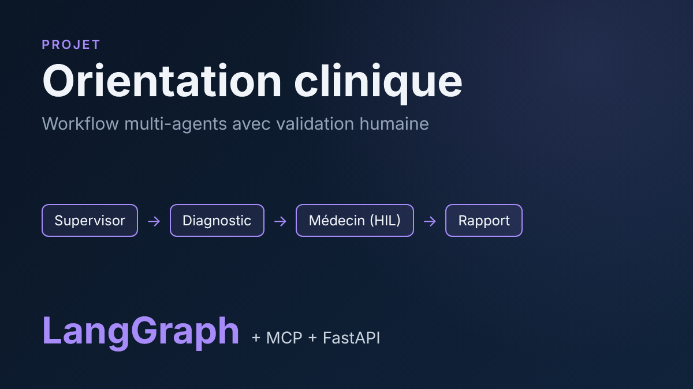
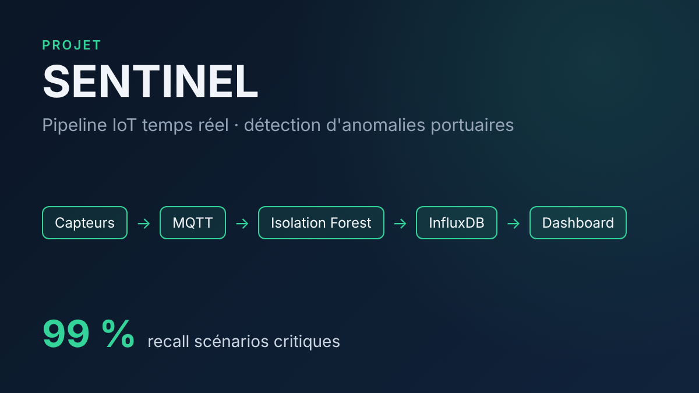
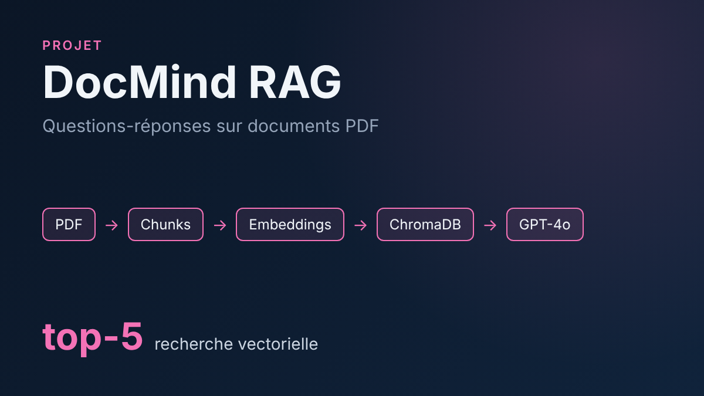
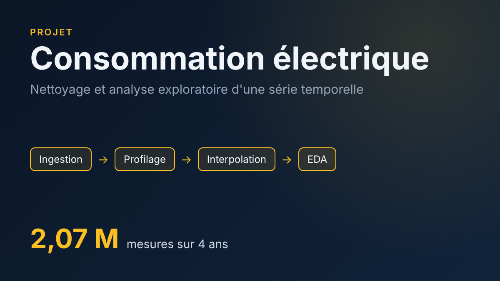
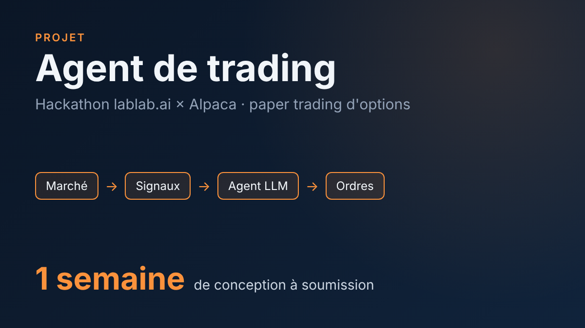

    

<h2 align="center">👋 Bonjour, je suis Mohamed Traoré</h2>

  Élève ingénieur en <b>IA &amp; Big Data</b> à HESTIM (Casablanca), en double diplôme <b>Master 2 Cyberdéfense des SI</b> avec l'UPHF (France). 
  Je construis des systèmes d'<b>IA agentique</b> et des <b>pipelines de données</b> qui restent fiables, traçables et conformes en conditions réelles.

  
  
  
  

---

<!-- Animation des contributions : générée chaque jour par .github/workflows/snake.yml -->

  <picture>
    <source media="(prefers-color-scheme: dark)" srcset="https://raw.githubusercontent.com/mohamed-943/mohamed-943/output/github-contribution-grid-snake-dark.svg">
    
  </picture>

## 🧠 Ce que je fais

- **IA agentique** : architectures multi-agents (LangGraph, orchestrateurs), validation humaine, traçabilité de chaque décision IA.
- **LLM &amp; RAG** : recherche vectorielle, prompt engineering, NLP multilingue, synthèse par LLM avec repli en cas de panne.
- **Data engineering** : collecte multi-sources, séries temporelles, qualité et gouvernance des données.
- **Sécurité &amp; conformité** : KYC / LCB-FT, protection des données personnelles, analyse de risques EBIOS RM.

## 🛠️ Stack technique

<b>Langages &amp; frameworks</b> 
  

<b>Data &amp; ML</b> 
    
  
  
  
  
  
  
  
  

<b>Cloud, DevOps &amp; outils</b> 
  

<b>En apprentissage</b> 
  
  
  
  

## 🚀 Projets phares

<table>
  <tr>
    <td width="33%" valign="top" align="center">
      
       <b><a href="https://github.com/mohamed-943/reputation-check">Reputation Check</a></b>
       Agent IA multi-agents de vérification de réputation (KYC / LCB-FT) : 5 agents, classifieur NLP en 5 langues, score de risque, rapport en 20 à 40 s.
       <code>Node.js</code> <code>React</code> <code>PostgreSQL</code> <code>LLM</code>
    </td>
    <td width="33%" valign="top" align="center">
      
       <b><a href="https://github.com/mohamed-943/medical-multiagent">Orientation clinique multi-agents</a></b>
       Workflow LangGraph à superviseur avec validation humaine par le médecin, outils exposés via MCP.
       <code>LangGraph</code> <code>FastAPI</code> <code>MCP</code> <code>Docker</code>
    </td>
    <td width="33%" valign="top" align="center">
      
       <b><a href="https://github.com/mohamed-943/sentinel-iot">SENTINEL</a></b>
       Pipeline IoT temps réel et détection d'anomalies en zone portuaire : 405 000 mesures, recall de 99 % sur les scénarios critiques.
       <code>MQTT</code> <code>Isolation Forest</code> <code>InfluxDB</code> <code>Flask</code>
    </td>
  </tr>
  <tr>
    <td width="33%" valign="top" align="center">
      
       <b><a href="https://github.com/mohamed-943/docmind-rag">DocMind RAG</a></b>
       Questions-réponses sur documents PDF par recherche vectorielle.
       <code>LangChain</code> <code>ChromaDB</code> <code>OpenAI</code> <code>Streamlit</code>
    </td>
    <td width="33%" valign="top" align="center">
      
       <b><a href="https://github.com/mohamed-943/household-energy-eda">Analyse de consommation électrique</a></b>
       Nettoyage et analyse exploratoire de 2,07 millions de mesures (4 ans, pas de 1 minute).
       <code>pandas</code> <code>seaborn</code> <code>CRISP-DM</code>
    </td>
    <td width="33%" valign="top" align="center">
      
       <b><a href="https://github.com/mohamed-943/alpaca-trading-agent">Agent de trading autonome</a></b>
       Agent d'options en paper trading, construit en une semaine au hackathon lablab.ai × Alpaca.
       <code>Python</code> <code>Alpaca API</code> <code>LLM</code>
    </td>
  </tr>
</table>

## 🎓 Certifications

  
  
  
  
  
  

## 🌍 Langues

  
  

## 📊 Statistiques GitHub

  
  

## 🤝 Me contacter

  Je cherche un <b>stage de fin d'études (PFE) de 4 à 6 mois à partir de février 2027</b> en <b>AI Engineering</b> ou <b>Data Engineering</b>, au Maroc, en France ou en Belgique. 
  Écrivez-moi à <a href="mailto:mohamednoordinetraore@gmail.com">mohamednoordinetraore@gmail.com</a> ou sur <a href="https://www.linkedin.com/in/mohamed-traor%C3%A9-737547361">LinkedIn</a>.

